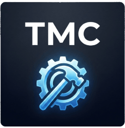
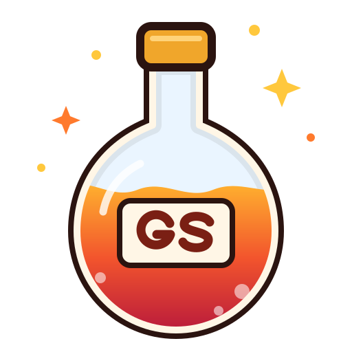
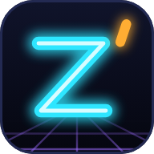

👋 Hi, I'm a *self-taught* **network**, **software**, and **systems engineer** with a strong passion for **open source**!

🙋‍♂️ My real name is **Christian**, but I often go by **Gamemann** or **WhoZ** online.

🛠️ I enjoy working with:
- 🐧 **Linux**
- 🌐 **Network engineering & security**
- 🔓 **Penetration testing**
- 💻 **Web development** & **web scraping**
- 🤖 **Bot development**
- 🎮 **Game development** & **game modding**

📁 Check out my:
-  🌐 [**Open source website portfolio**](https://cdeacon.net)
-  📄 [**Full list of open source projects**](./projects.md)

## 🚀 My Active Projects
###  [The Modding Community](https://moddingcommunity.com)
An inclusive **modding** and **game development** community. We offer a space where users can share game dev assets, mods, and track game/social servers. We are also creating our own [**gaming platform**](https://gamespice.net) built on-top of [Godot](https://godotengine.org) called [**GameSpice](https://gamespice.net)!

- 🎮 [Apps & Games](https://moddingcommunity.com/apps)
- 🔨 [Mod Workshop](https://moddingcommunity.com/mods)
- ⚙️ [Assets](https://moddingcommunity.com/assets) (game assets & more!)
- 🌐 [Server Browser](https://moddingcommunity.com/servers)
- 📝 [Blog](https://moddingcommunity.com/blog)
- 💻 [GitHub Org](https://github.com/modcommunity)

###  [GameSpice](https://gamespice.net)
An **open source** and **cross-platform** gaming platform built on-top of [Godot](https://godotengine.org) that puts community and game servers first.

- **Community servers first**: anyone can run a server for game on the platform. Servers register themselves, and a live server list shows who is playing right now.
- **Fully cross-platform**: play in a web browser, on Windows, macOS and Linux, or on a phone or tablet with touch controls.
- **Browser and native, same match**: web players connect over WebSocket (TCP) and native players over UDP. A single server accepts both, so everyone plays in the same server and match.
- **Play in seconds**: many games run in the browser with nothing to install and no account needed. Solo play, quick play and a server browser are built in.
- **Open and verifiable CDN**: each release is stored by content hash with a signed manifest. Players check every file against its hash, and anyone can run a mirror.
- **Built for developers**: Godot addons handle networking, bots, vehicles, weapons, maps, voice, stats, leaderboards and achievements, so you can work on the game itself.

###  [Zee's Games](https://zeesgames.com)
A collection of **open source** and *MIT-licensed* games I'm working on for [@modcommunity's](https://moddingcommunity.com/) gaming platform, [**GameSpice](https://gamespice.net), which is built on-top of [@godotengine](https://godotengine.org)! These games primarily serve as demonstrations of what the gaming platform is capable of, but I also like working on them for fun as well.

- [Airdrift](https://airdrift.net): A timer-based game with Source-style movement. Includes classic Surf Timer and Bunny Hop maps from Counter-Strike's custom/modded maps!
- [Fatal Contact](https://fatalcontact.net): Fast-paced shooter with sprinting, sliding, walling running, bunny hopping, surfing, and more!
- [Playlot](https://playlot.app): A physics sandbox: spawn props, NPCs and weapons and build whatever you like.
- [Zombie Zone](https://zeesgames.com/zombie-zone): Co-op zombie survival: escape through the city or survive waves.
- [10 more games...](https://zeesgames.com#games)

###  [TekWorks](https://tekworks.net)
A **software developer** and **publisher** organization. As of right now, TMC is the only project under TekWorks. However, in the future we intend on creating open source security and general purpose tools!

- 📝 [Blog](https://tekworks.net/blog)
- 💻 [GitHub Org](https://github.com/tek-works)

**NOTE**: I started using Claude Code on **July 8th, 2026** due to the amount of projects I'm working on and how much code is required. Most of my open source projects' code before that time was written by me. I strive to keep my **open source** projects updated, but as a solo developer juggling my own projects and professional work, it is hard for me to add features and address issues in a timely manner. Contributions are highly encouraged! Whether it’s a bug fix or a feature request, PRs are greatly appreciated, and all contributors will be credited in the README.

### [❤️ **I Lost My Mom To Pancreatic Cancer** ❤️](https://github.com/gamemann/i-lost-my-mom-to-pancreatic-cancer)

